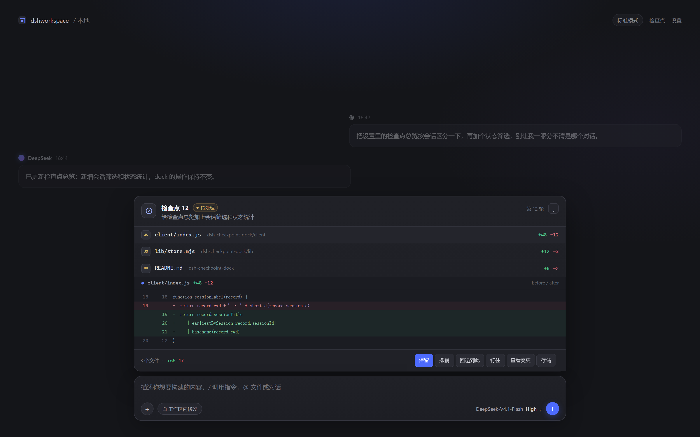

<p align="center">
  
</p>

<h1 align="center">dsh-checkpoint-dock</h1>

<p align="center">
  <a href="README.md">简体中文</a> | <b>English</b>
</p>

<p align="center">
  <a href="https://www.npmjs.com/package/dsh-checkpoint-dock"></a>
  = 0.2.2-rc.1" src="docs/badge-dsh.svg">
  <a href="LICENSE"></a>
</p>

An IDE-style checkpoint dock for DeepSeek Harness. Every turn in which the agent changes files gets its own checkpoint above the composer, with **Keep, Undo, Redo, and Revert to here** built in.

DSH's built-in “edited N files” card tells you what a turn produced. This plugin is the part that lets you take it back.

## Highlights

- **Per-turn, per-file checkpoints**: each checkpoint stores only the files that turn actually changed — no conversation copies, no whole-workspace snapshots.
- **A complete undo path**: Keep → Undo → Redo → Revert to here. Accept a turn, go back to before it, reapply it, or roll all the way back to an older turn. A revert can itself be taken back in one click, and checkpoints you already redid by hand are left out of that batch.
- **External writes are recorded too**: not just DSH's file tools — a shell command, a script, or an editor also lands in the checkpoint, because the workspace is compared at the start and at the end of a turn. Such a file carries a small "external" tag in the dock.
- **Restores are transactional**: a multi-file undo, redo or revert writes an intent journal first, then replaces files one by one. If the process dies halfway, the first operation of the next start finishes the restore instead of leaving the workspace split between two turns; if a target file was edited after the crash, the restore stops and asks first (finish it, or drop it).
- **See the change in place**: expand a before/after diff inside the dock; a file row expands only that file's patch and **View all changes** expands the whole turn. With a single changed file that button turns into **Hide all changes**.
- **Resident, but quiet**: the welcome page shows no dock; once a conversation starts the dock keeps a collapsed row even before the first checkpoint. Turn residency off and it appears only while a turn has unhandled file changes.
- **Multiple sessions stay separate**: the overview groups checkpoints by DSH session title, and the Storage tab shows a per-session usage pie, labelling sessions you archived in DSH.
- **No git dependency**: no repository, no commit, and `git gc` cannot make old checkpoints unreachable. A small tree is scanned directly; a large tree that happens to be a git repository is read through `git status`, which skips the full scan. Inside a repository the checkpoint also keeps the short HEAD hash at turn end, and a rename is shown as one row (`new ← old`) instead of a delete plus a create.
- Checkpoint contents are compressed before they reach the disk (zstd when the runtime has it, gzip otherwise), and only when that actually makes them smaller: small or already-random files are stored exactly as they are. Packing happens before encryption, so sealed blobs benefit too. Each stored file carries a short `DSKZ` header naming the codec; blobs written by older builds have no header and are read back untouched, so no migration is needed.
- **Optional encryption**: off by default. When enabled, checkpoint content is sealed with AES-256-GCM and the keys live outside the checkpoint directory in `$DSH_HOME/checkpoint-keys/`; resetting a key only adds another one, so old content stays readable.
- **Native DSH styling**: buttons, menus, colors, and the settings page use DSH theme tokens.

## How it compares

> Information about similar tools comes from their public docs (as of Nov 2026). This is a mechanism comparison only; it does not evaluate implementations. Current reference implementations: `dsh-checkpoint-rewind` (workspace/config/session snapshots), `dsh-snapshot-manager` (whole-workspace snapshots and conversation rollback), `dsh-checkpoint-diff` (read-only diff on top of rewind). Names only, no links.

| Capability | This plugin | `dsh-checkpoint-rewind` | `dsh-snapshot-manager` | `dsh-checkpoint-diff` |
| --- | --- | --- | --- | --- |
| Scope | Files changed per turn | Workspace + config + session cursor | Whole workspace | No snapshots; reads rewind snapshots |
| Diff | Inline before/after | Tree diff in panel | Snapshot diff in panel | Any two checkpoints |
| Restore | Keep / Undo / Redo / Revert here / take a revert back | `/rewind`, selective restore | File rollback + conversation fork | Rollback (via rewind) |
| External writes | Compared per turn, git used when it pays | Covered by the snapshot | Covered by the whole-workspace snapshot | Inherited from rewind |
| Transactional restore | Intent journal, finished after a crash | No | No | No |
| Conversation / config restore | No | Yes | Conversation | No |
| Git dependency | None, optionally used | git or copy mode | None | Inherited from rewind |
| Best for | Day-to-day file edits | Whole three-state rollback | Broad snapshot rollback | Inspecting historical diffs |

Snapshot-style tools are a better fit when you need workspace, config, or session coverage. This plugin takes a different path: **small, fast, and file-focused**. No whole-workspace copy, no conversation fork, no config restore, no git. The trade-off is that it covers file contents only, not session state.

## Install

Requires DSH `>= 0.2.2-rc.1`. Published on npm: [dsh-checkpoint-dock](https://www.npmjs.com/package/dsh-checkpoint-dock).

Inside DSH (the easy way): open **Settings → Plugins**, click **Add plugin**, and enter `dsh-checkpoint-dock`.

From npm:

```powershell
dsh plugin --profile desktop add dsh-checkpoint-dock
```

From a local directory:

```powershell
dsh plugin --profile desktop add D:\\path\\to\\dsh-checkpoint-dock
```

You can also pick the local bundle from the Plugins page. Refresh the page afterwards and the dock shows up.

The plugin ships two halves: Host code (`index.mjs`, `lib/`) and client code (`client/index.js`). **Restart DSH once after the first install or an upgrade** so the Host half picks up the new code; a page refresh only reloads the client half. If the dock disappears right after an upgrade, the Host plugin probably failed to import — look for the `checkpoint-dock` error in the DSH log.

Uninstall:

```powershell
dsh plugin --profile desktop remove dsh-checkpoint-dock
```

Uninstalling leaves existing checkpoints in place; the data stays in `$DSH_HOME/edit-checkpoints/` until you delete it yourself.

## Usage

1. Let the agent modify files during a turn.
2. A checkpoint appears above the composer. Expand it to see the files and the diff.
3. Use **Keep / Undo / Redo / Revert to here** on that turn; a file row expands only its own patch, **View all changes** expands the whole turn and collapses it again.
4. The welcome page shows no dock; once you send the first message the dock keeps a single collapsed row even if the turn changed no files, and expanding it says there are no checkpoints yet.

To browse everything, open **Settings → Checkpoints → Overview**; cleanup and encryption live under **Config**; usage and the per-session pie live under **Storage**.

A turn settles its files when it ends: the workspace is compared at the start and at the end, and every difference is recorded — so a file written by a shell command, a script, or an editor shows up in the checkpoint just like one written by DSH's own file tools. A small tree is scanned as a whole; a large one that is a git repository is compared through `git status` plus `git cat-file`, reading only the files that really changed.

When residency is off, the dock appears only while a turn has unhandled file changes and hides again once they are handled. Settings are stored per browser and shared across DSH ports on the same machine.

Checkpoints are numbered in session order, and the overview groups them by DSH session title, so checkpoints from different conversations never blur together.

## Keep, Undo, and Redo

- Undo N restores the disk state from before the first write of turn N — not the state at the moment you clicked Keep. Keep itself does not modify files.
- Keeping the latest checkpoint also marks every earlier un-reverted checkpoint as kept.
- Once a later checkpoint is kept, earlier checkpoints cannot be undone individually, even if the two turns touched different files. Use **Revert to here** for a whole-range rollback.
- Undo / Redo / Revert verify each file's current hash first. If another tool or a manual edit changed the file, they report a conflict instead of overwriting it.
- A multi-file restore writes an intent journal (`$DSH_HOME/edit-checkpoints/pending.json`) before touching any file, then replaces files, and only then updates the record. If the process dies halfway, the first operation of the next start finishes that restore, so the workspace never stays split between two turns and no restored file is left marked as sealed.
- Redo only works from the earliest undone checkpoint forward. A newer active checkpoint blocks it.
- Revert undoes every checkpoint after the target. Those records become undone and can be redone in order; the dock keeps a **Take that revert back** row that redoes the whole batch.

## Data and privacy

- Checkpoint data is **stored in plain text by default** under `$DSH_HOME/edit-checkpoints/` and includes the contents of changed files; encryption can be enabled on the Config tab. Either way, do not commit this directory or sync it to an untrusted location.
- `.env*`, private keys, `.ssh/.aws/.gnupg`, `.npmrc`, `.yarnrc*`, `.pypirc`, `.git-credentials`, `kubeconfig`, `secrets.yaml/json`, `.docker/`, `*.kdbx`, and similar names are skipped by default: a matching file keeps its path and hash in the record, but its contents never enter a checkpoint. This is a best-effort filter, not encryption, and not a replacement for secret management.
- Tighten the data directory to yourself: `chmod 700 $DSH_HOME/edit-checkpoints`. Keep the DSH web UI bound to `127.0.0.1` and do not forward the port — any client that can reach the gateway can trigger `undo`/`revert` and change workspace files; the confirmation dialog is not a security boundary.
- A restore writes `.dsh-ckpt-<pid>-<n>.tmp` next to the target file and removes it when done. A file left behind by a DSH crash is safe to delete.

The intent journal (`$DSH_HOME/edit-checkpoints/pending.json`) records the hash each target is expected to have before it is replaced, and is flushed to disk before the first file is touched. If a target changed after a crash, the restore stops and the dock offers **Finish the restore** or **Drop that restore** instead of overwriting the edit.
- External-write detection has a budget. The whole-tree scan skips `.git`, `node_modules`, `.tmp` and similar directories, skips every dot-directory (`.github/`, `.vscode/`, `.config/`), caps a single file at 4 MiB, and stops at 4000 files or 32 MiB in total. The git path keeps content only for files that were already dirty at turn start, capped at 2000 files or 32 MiB. A turn that exceeds the budget records only DSH file-tool writes.
- The per-file limit is 4 MiB. Larger files are recorded with approximate line counts and are excluded from safe undo.
- The Config tab can turn on **Encrypt checkpoint content**. It is off by default: once encryption is on, losing or deleting `$DSH_HOME/checkpoint-keys/` leaves those checkpoints visible only as "its key is missing" — no undo, no diff. New content is sealed immediately; older content is encrypted in batches on later turns (up to 40 blobs per turn) and can be switched off at any time. Keys are only ever added, so restoring an old key file makes its blobs readable again. Once encryption is on, the Config tab also shows Rotate key: it mints one new key for later checkpoints and leaves older content readable. Switching encryption off while sealed blobs remain reports it: the old content still opens, but new writes go back to plaintext.
- A damaged record file is renamed to `*.corrupt-<timestamp>` and isolated. Only that entry is lost; the rest of the session keeps working.
- Deleting a session in DSH does not delete its checkpoints. Settings → Checkpoints → Storage lists them as deleted-session data and lets you decide when to clean up.
- The Settings → Checkpoints → Config page can enable automatic cleanup and pick how many recent checkpoints to keep (10–200). When enabled, the oldest content is trimmed at the end of any turn that exceeds the limit; pinned checkpoints are never cleaned. The Storage tab only reports: total usage, record count, and a per-session usage pie. The same page holds a storage warning, on by default at 500 MB (100 MB / 250 MB / 500 MB / 1 GB / 2 GB). Once usage passes it, both the Storage tab and the checkpoint dock under the input show a line — it only warns, nothing is deleted. A session you archived in DSH is labelled "Archived" in the legend — archiving only files it away in the sidebar, and both the directory and its checkpoints stay on disk.

## Limitations

- Only files inside the current workspace are handled.
- Every dot-directory is skipped, so content changed by a shell command inside `.github/`, `.vscode/` or `.config/` is never noticed (writes through DSH's file tools still are). A dot-file at the workspace root (a `.gitignore`, say) is read, but one that matches the sensitive list (`.env`) keeps only its path and hash.
- The git path cannot see files ignored by `.gitignore` — build output, `node_modules`, logs. The scan skips those directories too, so both paths agree.
- On a very large tree external-write detection degrades: the turn that exceeds the budget records only DSH file-tool writes, and so does a turn where the git command fails.
- Restores file bytes and permission bits; it does not restore mtime, directories, symlink targets, or `.git` metadata.
- Undo / Revert are overwrite-style restores: files created outside the reverted turn are not deleted.
- Cross-session protection is checked on Undo / Redo / Revert, not as a continuous file-edit lock. Two sessions can still write the same file concurrently; if the other session's write lands before this turn is sealed, this turn's after state may already contain it. Fully preventing that requires workspace-level write serialization.
- No whole-workspace snapshots, conversation rollback, or config rollback. Use a dedicated checkpoint/snapshot plugin for those.
- Checkpoints of deleted sessions are not reclaimed automatically; clean them up from Settings → Checkpoints → Storage. The cleanup skips records written in the last hour so a freshly created session is never touched.
- v1 records have no after content, so diff and redo are unavailable for them. There is no automatic migration.
