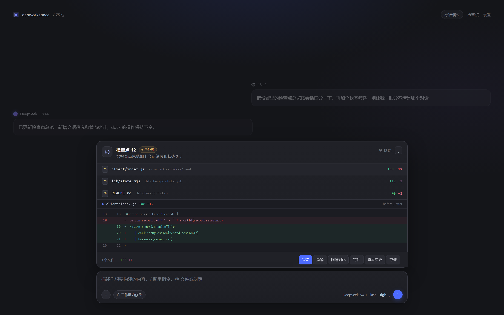

<p align="center">
  
</p>

<h1 align="center">dsh-checkpoint-dock</h1>

<p align="center">
  <b>简体中文</b> | <a href="README.en.md">English</a>
</p>

<p align="center">
  <a href="https://www.npmjs.com/package/dsh-checkpoint-dock"></a>
  = 0.2.2-rc.1" src="docs/badge-dsh.svg">
  <a href="LICENSE"></a>
</p>

为 DeepSeek Harness 提供一个 IDE 风格的检查点 dock：agent 每一轮改过哪些文件、改了什么，都会出现在输入框上方，并且可以直接 **保留、撤销、重做、回退**。

DSH 自带的“已编辑 N 个文件”卡片负责告诉你这一轮产出了什么；这个插件负责的是**改完之后还能反悔**。

## 特色

- **按轮次、按文件记录**：每个检查点只保存这一轮真正改过的文件，不复制对话，也不做整工作区快照。
- **完整的反悔链**：保留 → 撤销 → 重做 → 回退到此，覆盖“接受这一轮”“退回这一轮之前”“恢复这一轮之后”“退回到很久以前的某一轮”。回退之后还能一键反悔整批，自己手动重做过的那些不会重复执行。
- **外部写入一样能记**：不只 DSH 的文件工具，shell 命令、脚本、编辑器直接写下的文件也会进检查点——轮首和轮末各比对一次工作区，差异补记进来；这类文件在 dock 里会带一个「外部」小标签。
- **恢复是事务性的**：多文件撤销 / 重做 / 回退会先写一份意图日志，再逐个文件替换；中途崩溃，下次启动插件的第一个操作会把这次恢复做完。如果崩溃之后目标文件又被你改过，它会停下来等你确认（继续恢复 / 放弃这次恢复），而不是直接覆盖。
- **改了什么，当场能看**：dock 内直接展开 before/after diff；点文件行只展开那一个文件，点“查看所有变更”展开全部——只有一个文件时，这个按钮自动变成“收起所有变更”。
- **常驻但不碍事**：空白页（还没开始对话）不显示；开始对话后保持一行收起的标题，即使还没有检查点；关闭常驻后，只有出现未处理的文件改动才出现，处理完自动收起。
- **多会话不混**：设置里的总览按 DSH 会话标题分组，每条记录还标出各自占用的磁盘空间；存储页用饼图展示每个会话占多大空间，已归档的会话会标出来。
- **不依赖 git**：不初始化仓库、不做 commit，检查点也不会因为 `git gc` 失效。工作区很大又是 git 仓库时，只读 `git status` 报告的路径来省掉整树扫描；有 git 时还会记下每轮结束的 commit 短哈希，重命名识别成一条「新路径 ← 旧路径」。
- **可选加密**：默认关闭；开启后检查点内容用 AES-256-GCM 加密，密钥放在检查点目录之外的 `$DSH_HOME/checkpoint-keys/`，重置密钥只是换一把新的，旧内容照样能读。
- **原生 DSH 风格**：按钮、菜单、配色和设置页都使用 DSH 的主题变量，和内置界面保持一致。

## 和同类工具的区别

> 同类工具信息来自各自公开文档（截至 2026-11）；这里只做机制对照，不评价实现质量。当前可对照的实现有 `dsh-checkpoint-rewind`（工作区/配置/会话快照）、`dsh-snapshot-manager`（整工作区快照与对话回退）、`dsh-checkpoint-diff`（基于 rewind 的只读 diff）。只写名称，不附链接。

| 能力 | 本插件 | `dsh-checkpoint-rewind` | `dsh-snapshot-manager` | `dsh-checkpoint-diff` |
| --- | --- | --- | --- | --- |
| 记录范围 | 每轮改动的文件 | 工作区 + 配置 + 会话游标 | 整工作区 | 不产生快照，读取 rewind 快照 |
| 查看 diff | dock 内 before/after | 面板内树 diff | 面板内快照 diff | 任意两个检查点对比 |
| 回退能力 | 保留 / 撤销 / 重做 / 回退到此 / 反悔回退 | `/rewind`、选择性恢复 | 文件回退 + 对话 fork | 回滚（依赖 rewind） |
| 外部写入 | 轮首轮末比对工作区，可选走 git | 快照天然覆盖 | 整工作区快照覆盖 | 继承 rewind |
| 恢复事务性 | 意图日志 + 崩溃续做 | 无 | 无 | 无 |
| 恢复对话 / 配置 | 不支持 | 支持 | 支持对话 | 不支持 |
| 依赖 git | 不依赖，可选联动 | git 或复制模式 | 不依赖 | 继承 rewind |
| 适合 | 逐轮文件改动 | 整体三态回退 | 大范围快照回退 | 纯查看历史差异 |

快照类工具更擅长覆盖工作区、配置和会话状态；这个插件走的是另一条路：**轻、快、只围绕文件改动**。不复制整个工作区，不 fork 对话，不恢复配置，不依赖 git。代价是只覆盖文件内容，不覆盖会话状态。

## 安装

要求 DSH `>= 0.2.2-rc.1`。包已发布在 npm：[dsh-checkpoint-dock](https://www.npmjs.com/package/dsh-checkpoint-dock)。

在 DSH 里装（最省事）：打开**设置 → 插件**，点**添加插件**，输入 `dsh-checkpoint-dock` 即可。

从 npm：

```powershell
dsh plugin --profile desktop add dsh-checkpoint-dock
```

从本地目录：

```powershell
dsh plugin --profile desktop add D:\\path\\to\\dsh-checkpoint-dock
```

也可以在插件页选择本地 bundle。装完刷新页面就能看到 dock。

插件由 Host 侧代码（`index.mjs`、`lib/`）和客户端代码（`client/index.js`）两半组成：**首次安装或升级后重启一次 DSH**，Host 侧才会加载新代码；只刷新页面只更新客户端那一半。升级后如果 dock 突然不见，多半是 Host 插件 import 失败，可以在 DSH 日志里搜 `checkpoint-dock` 的报错。

卸载：

```powershell
dsh plugin --profile desktop remove dsh-checkpoint-dock
```

卸载不会删除已有检查点，数据仍在 `$DSH_HOME/edit-checkpoints/`，需要的话手动删目录。

## 使用

1. 让 agent 在一轮里修改文件。
2. 输入框上方会出现对应检查点，点开可以看到文件和 diff。
3. 用 **保留 / 撤销 / 重做 / 回退到此** 处理这一轮的修改；点某个文件只展开它的补丁，点“查看所有变更”展开整轮，再点一次收起。
4. 空白页（还没开始对话）不显示 dock；发出第一条消息后，即使这一轮没改文件，dock 也保持一行收起的标题，点开显示「当前暂无检查点」。

想回看所有历史，进 **设置 → 检查点 → 总览**；清理与加密在 **配置**；占用统计和按会话的饼图在 **存储**。

一轮的文件改动在轮次结束时结算：轮首和轮末各比对一次工作区，差异都会补记——因此 shell 命令、脚本、编辑器直接写下的文件，和 DSH 文件工具写的一样会出现在检查点里。小工作区直接扫描整棵树；工作区很大、又恰好是 git 仓库时，改用 `git status` 加 `git cat-file`，只读真正变了的文件。结束时如果在一个仓库里，检查点还会记下当时的 commit 短哈希，显示在轮次标题旁。

常驻关闭后，只有出现尚未处理的文件改动时 dock 才会出现，处理完自动收起。设置按浏览器保存，同一台机器的不同 DSH 端口共用。

检查点按会话内顺序编号，设置总览按 DSH 会话标题分组；多个对话同时改文件时，也能分清每条检查点属于哪个会话。

## 保留、撤销与重做

- 撤销 N 恢复的是“第 N 轮第一次写这些文件之前”的磁盘内容，不是“点击保留那一刻”的内容。保留本身不改文件。
- 保留最新一条，会把之前所有未撤销的检查点一并标记为已保留。
- 某个检查点之后只要有已保留的检查点，更早的检查点就不能再单独撤销，即使两轮改的是不同文件；需要整体回退时用“回退到此”。
- 撤销 / 重做 / 回退会先校验每个文件的当前 hash；文件被其他工具或手工改过时会报冲突，不会强行覆盖。
- 恢复多个文件时先落一份 `$DSH_HOME/edit-checkpoints/pending.json`（意图日志，带每个文件写入前应有的哈希），再逐个文件写入，最后才更新记录状态；中途崩溃，下次启动插件的第一个操作会把这次恢复做完。若崩溃之后目标文件又被改过，恢复会停下并在 dock 里给出「继续恢复 / 放弃这次恢复」。
- 重做只能从最早的已撤销检查点开始，依次向后；中间有更新的活跃检查点时会挡住重做。
- 回退会撤销目标之后的所有检查点，这些记录进入“已撤销”，可以再按顺序重做；dock 会在过滤行下方留一行「反悔这次回退」，点一下整批重做。

## 数据与隐私

- 检查点数据**默认以明文保存在 `$DSH_HOME/edit-checkpoints/`**，包含被修改文件的内容；可以在「配置」页开启加密。无论是否加密，都不要把这个目录提交到仓库或同步到不可信位置。
- 默认跳过 `.env*`、私钥、`.ssh/.aws/.gnupg`、`.npmrc`、`.yarnrc*`、`.pypirc`、`.git-credentials`、`kubeconfig`、`secrets.yaml/json`、`.docker/`、`*.kdbx` 等敏感路径；命中的文件仍记录路径和哈希，但内容不进入检查点。这是尽力而为的过滤，不是加密。
- 建议把数据目录收紧到只有自己可读：`chmod 700 $DSH_HOME/edit-checkpoints`。同时让 DSH 网页只绑 `127.0.0.1`，不要做端口转发——任何能调用网关的客户端都能触发 `undo`/`revert` 改工作区文件，前端那个确认框不算安全边界。
- 恢复时会在目标文件同目录写 `.dsh-ckpt-<pid>-<n>.tmp`，正常结束会删除；DSH 崩溃留下的这类文件不会被自动清理，可以安全删除。
- 外部写入的检测有预算：整树扫描跳过 `.git`、`node_modules`、`.tmp` 这类目录，也跳过所有以点开头的目录（`.github/`、`.vscode/`、`.config/` 等），单文件上限 4 MiB，整体最多 4000 个文件 / 32 MiB；走 git 时只为轮首已经脏的文件保留内容，上限 2000 个文件 / 32 MiB。超出预算的那一轮只记录 DSH 文件工具的写入。
- 单文件上限为 4 MiB；超过上限的文件只记录近似行数，不参与安全撤销。
- 检查点内容在落盘前会压缩（优先 zstd，运行时不支持就退回 gzip），只有确实能变小才压：小文件和本来就随机的文件原样保存。压缩发生在加密之前，所以已加密的 blob 同样受益；磁盘上的文件带一个很短的 `DSKZ` 头标明用了哪种压缩，旧版本写入的 blob 没有这个头，会被原样读出，不需要迁移。
- 「配置」页可以开启「加密检查点内容」。默认关闭：加密后一旦 `$DSH_HOME/checkpoint-keys/` 丢失或被删，那些检查点就只能看到「密钥不在本机」，不能撤销也不能看 diff。开启时新内容立即加密，旧内容在后续轮次里每次加密一批（每轮最多 40 个 blob），可随时关掉；密钥只增不删，恢复旧密钥文件即可重新读到旧内容。开启后「配置」页会多出「重置密钥」：它只生成一把新密钥给之后的检查点用，旧内容不受影响。如果关掉开关时还有已加密的内容，页面会提示「旧内容仍能读、新写入回到明文」，不会把已有密文弄丢。
- 记录文件损坏时会被改名为 `*.corrupt-<时间戳>` 隔离，只影响那一条，同会话其他检查点照常可用。
- 在 DSH 里删除会话不会自动删除它的检查点。「设置 → 检查点 → 存储」会把这类记录列为「已删除的会话」，由你决定何时清理。
- 「配置」页可以开启「自动清理检查点」，并选择保留最近多少条（10–200 条）。开启后每轮结束时若超出上限，就自动清掉最早那些记录的内容；钉住的检查点不会被清理。「存储」页只做统计：总占用、记录数，以及按会话的占用饼图；在 DSH 里归档的会话会在图例里标上「已归档」——归档只是从侧边栏收起来，目录和检查点都还在。
- 「配置」页还能设一个存储提醒：默认开，默认 500 MB（可选 100 MB / 250 MB / 500 MB / 1 GB / 2 GB）。占用越过阈值后，「存储」页和输入区下方的检查点 Dock 都会显示一行提醒；只提醒，不会自动删任何东西。

## 已知限制

- 只处理当前工作区内的文件；工作区外和临时文件不进入检查点。
- 跳过所有以点开头的目录，所以 `.github/`、`.vscode/`、`.config/` 里被 shell 改的内容不会被发现（DSH 文件工具改的仍会记录）。工作区根目录下的点文件（如 `.gitignore`）会被读到，但命中敏感名单的（如 `.env`）只记录路径和哈希，不保存内容。
- 走 git 的路径看不到被 `.gitignore` 忽略的文件：构建产物、`node_modules`、日志之类不会进入检查点。没有 git 时扫描本身也会跳过这些目录，两种方式的结果一致。
- 工作区很大时外部写入检测会降级：超过预算的那一轮只记录 DSH 文件工具的写入；走 git 时如果 git 命令失败，同样只记录文件工具写入。
- 只恢复文件字节和权限位，不恢复 mtime、目录、符号链接目标或 `.git` 元数据。
- 撤销 / 回退是覆盖式恢复：不会删除本轮之外新建的文件。
- 跨会话保护只在撤销 / 重做 / 回退时检查，不是持续性的文件编辑锁。两个会话仍可以同时写同一个文件；如果对方写入发生在本轮封存之前，本轮 after 可能已经包含对方字节。要彻底避免，需要工作区级的写入串行化。
- 不提供整工作区快照、对话回退或配置回退；需要这些能力请使用专门的 checkpoint / snapshot 插件。
- v1 旧记录没有 after 内容，diff 和重做不可用；不做自动迁移。
- 已删除会话的检查点不会自动回收，需要在「设置 → 检查点 → 存储」手动清理；清理会跳过最近 1 小时内还在写入的记录，避免误删刚创建的会话。
